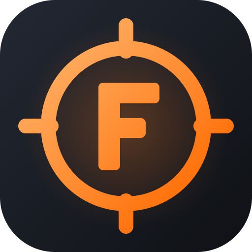

  

<h1 align="center">FragLab</h1>

  A CS2 practice and training app. Pick a mode, hit start, and train on your own server. 
  Part of the <b>FragLab</b> family.

  <a href="https://github.com/M0RTENS3N/fraglab/releases/latest"><b>⬇️ Download the latest version</b></a>

---

## What it does

- **Nade practice**: unlimited utility, `sv_cheats` and grenade trajectories enabled for you.
  - Save lineups with a screenshot, and teleport straight back to any saved lineup.
- **Bots & Deathmatch**: aim warm-ups with live stats (kills, accuracy, headshot %).
- **Lockdown**: hold an angle against waves of bots and track your best runs.
- **Gauntlet**: fight through bot courses from start to finish against the clock.
- **Spray Control**: spray at a wall and get a score for how tight your pattern was.
- **Movement**: bhop and strafe practice.
- **Routines**: build a daily training plan that chains several modes and runs them all on the server.
- **Records & stats**: your history, personal bests and progress across every mode.
- **Skins**: try out weapon skins, knives and gloves on your local practice server.

## Install

1. Download **FragLab-Setup-x.y.z.exe** from the [latest release](https://github.com/M0RTENS3N/fraglab/releases/latest).
2. Run it.
3. Open **FragLab** from the Start Menu.

When a new version is out, a banner appears in the app. Click **Update** to install it.

**Optional:** FragLab can set up a local CS2 dedicated server with the FragLab plugin. Every mode then runs on the server, which adds menus, stats and records.

**Requirements:** Windows 10/11 (64-bit) and Counter-Strike 2 (Steam).

## Privacy

FragLab runs entirely on your PC. Your settings, lineups, stats and records are stored locally. The app only goes online to check GitHub for updates and to load skin images.

---

Not affiliated with Valve. Counter-Strike 2 is a trademark of Valve Corporation.
